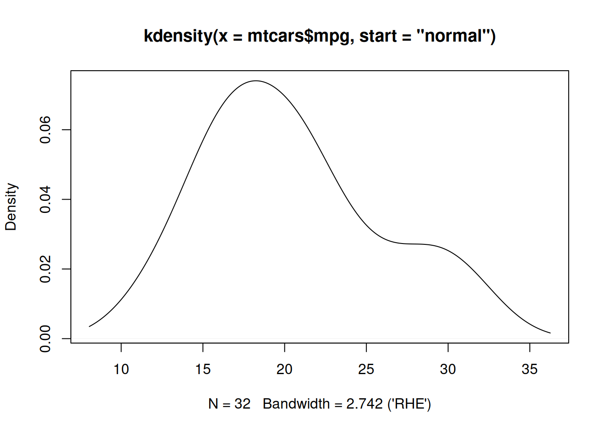
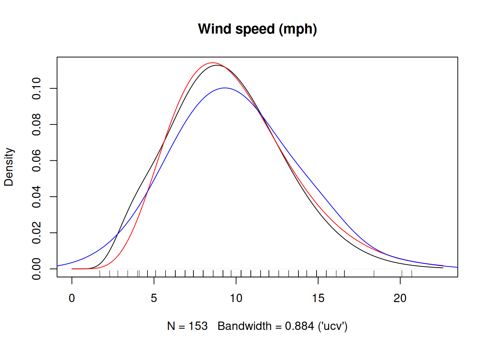

<!-- README.md is generated from README.Rmd. Please edit that file -->

# kdensity 

[](https://github.com/JonasMoss/kdensity/actions)
[](https://app.codecov.io/gh/JonasMoss/kdensity)
[](https://cran.r-project.org/package=kdensity)
[](https://zenodo.org/badge/latestdoi/120678148)
[](https://www.repostatus.org/#inactive)

An `R` package for univariate kernel density estimation with parametric
starts and asymmetric kernels.

kdensity is in maintenance mode: it gets bug fixes and the changes
needed to stay on CRAN, but no new features.

## Overview

kdensity implements univariate kernel density estimation with roughly
the same syntax as `stats::density`, adding three things: *parametric
starts*, *asymmetric kernels*, and configurable bandwidth selection.
Built-in parametric starts include `normal` and `gamma` (see
[`univariateML`](https://github.com/JonasMoss/univariateML) for the full
list), and the asymmetric kernels include `gcopula` and Chen’s `gamma`
and `beta` kernels; you can also supply your own starts, kernels, and
bandwidth functions. The return value is itself a density function,
ready for numerical integration, differentiation, or point evaluation.

## Installation

From inside `R`, use one of the following commands:

``` r
# For the CRAN release
install.packages("kdensity")
# For the development version from GitHub:
# install.packages("devtools")
devtools::install_github("JonasMoss/kdensity")
```

## Usage Example

Call the `library` function and use it just like `stats::density`, but
with optional additional arguments.

``` r
library("kdensity")
plot(kdensity(mtcars$mpg, start = "normal"))
```



## Description

Kernel density estimation with a *parametric start* was introduced by
Hjort and Glad in [Nonparametric Density Estimation with a Parametric
Start (1995)](https://projecteuclid.org/euclid.aos/1176324627). The idea
is to start out with a parametric density before you do your kernel
density estimation, so that your actual kernel density estimation will
be a correction to the original parametric estimate. The resulting
estimator will outperform the ordinary kernel density estimator in terms
of asymptotic integrated mean squared error whenever the true density is
close to your suggestion, and the estimator can be superior to the
ordinary kernel density estimator even when the suggestion is pretty far
off.

In addition to parametric starts, the package implements some
*asymmetric kernels*. These kernels are useful when modelling data with
sharp boundaries, such as data supported on the positive half-line or
the unit interval. Currently we support the following asymmetric
kernels:

- Jones and Henderson’s *Gaussian copula KDE*, from [Kernel-Type Density
  Estimation on the Unit Interval
  (2007)](https://academic.oup.com/biomet/article-abstract/94/4/977/246269).
  This is used for data on the unit interval. The bandwidth selection
  mechanism described in that paper is implemented as well. This kernel
  is called `gcopula`.

- Chen’s two *beta kernels* from [Beta kernel estimators for density
  functions
  (1999)](https://www.sciencedirect.com/science/article/pii/S0167947399000109).
  These are used for data supported on the unit interval, and are called
  `beta` and `beta_biased`.

- Chen’s two *gamma kernels* from [Probability Density Function
  Estimation Using Gamma Kernels
  (2000)](https://link.springer.com/article/10.1023/A:1004165218295).
  These are used for data supported on the positive half-line, and are
  called `gamma` and `gamma_biased`.

These features can be combined to make asymmetric kernel density
estimators with parametric starts, see the example below. The package’s
two main functions are `kdensity()` and `kdensity_grid()`, in addition
to methods for generics such as `plot()`, `points()`, `lines()`,
`summary()`, and `print()`.

## Usage

The function `kdensity` takes some `data`, a kernel `kernel` and a
parametric start `start`. You can optionally specify the `support`
parameter, which is used to find the normalizing constant.

The following example uses the `datasets::airquality` data set. The
black curve is a gamma-kernel density estimate with a gamma start, the
red curve a fully parametric gamma density, and the blue curve an
ordinary `density` estimate. Notice the boundary bias of the ordinary
`density` estimator. The underlying parameter estimates are always
maximum likelihood.

``` r
library("kdensity")
kde <- kdensity(airquality$Wind, start = "gamma", kernel = "gamma")
plot(kde, main = "Wind speed (mph)")
lines(kde, plot_start = TRUE, col = "red")
lines(density(airquality$Wind, adjust = 2), col = "blue")
rug(airquality$Wind)
```



Since the return value of `kdensity` is a function, `kde` is callable
and can be used as any density function in `R` (such as `stats::dnorm`).
For example, you can do:

``` r
kde(10)
#> [1] 0.1101274
integrate(kde, lower = 0, upper = 1) # The cumulative distribution up to 1.
#> 9.499222e-06 with absolute error < 1.5e-11
```

For large plotting grids, `kdensity_grid()` provides an explicitly
approximate binning-and-FFT backend for every built-in symmetric kernel
and the Gaussian-copula kernel. Calling `kde()` remains exact.

You can access the parameter estimates by using `coef`. You can also
access the log likelihood (`logLik`), AIC and BIC of the parametric
start distribution.

``` r
coef(kde)
#> Maximum likelihood estimates for the Gamma model 
#>  shape    rate  
#> 7.1873  0.7218
logLik(kde)
#> 'log Lik.' -410.5129 (df=2)
AIC(kde)
#> [1] 825.0259
```

## References

- [Hjort, Nils Lid, and Ingrid K. Glad. “Nonparametric density
  estimation with a parametric start.” The Annals of Statistics (1995):
  882-904.](https://projecteuclid.org/euclid.aos/1176324627).

- [Jones, M. C., and D. A. Henderson. “Miscellanea kernel-type density
  estimation on the unit interval.” Biometrika 94.4 (2007):
  977-984.](https://academic.oup.com/biomet/article-abstract/94/4/977/246269).

- [Chen, Song Xi. “Probability density function estimation using gamma
  kernels.” Annals of the Institute of Statistical Mathematics 52.3
  (2000):
  471-480.](https://link.springer.com/article/10.1023/A:1004165218295).

- [Chen, Song Xi. “Beta kernel estimators for density functions.”
  Computational Statistics & Data Analysis 31.2 (1999):
  131-145.](https://www.sciencedirect.com/science/article/pii/S0167947399000109)

- [Hallberg Szabadváry, Johan. “A Fast, Closed-Form Bandwidth Selector
  for the Beta Kernel Density Estimator.” arXiv preprint
  arXiv:2601.19553 (2026).](https://arxiv.org/abs/2601.19553)
